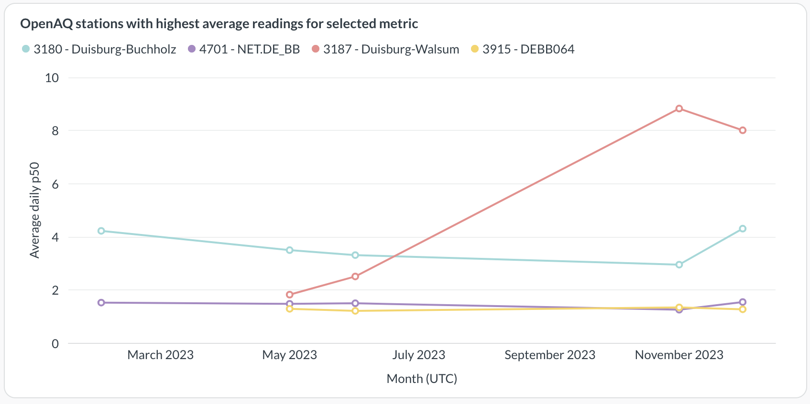
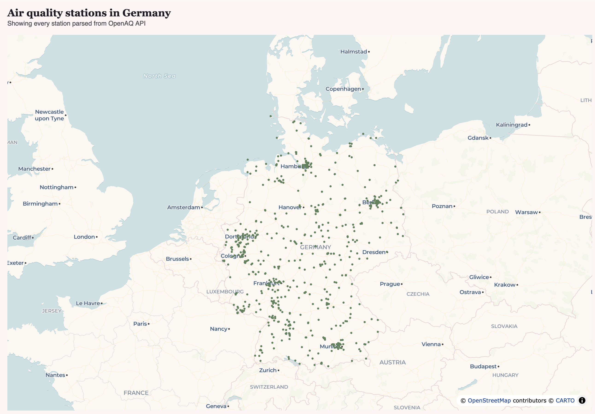
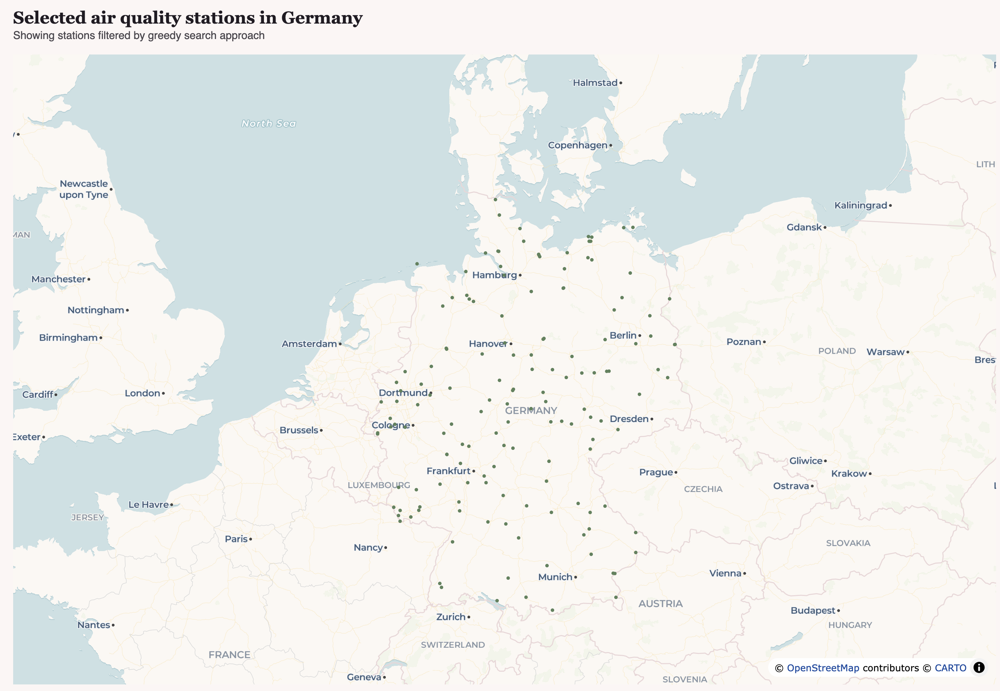

# Energy air quality analysis

This repository contains an end-to-end analysis on the impact of power plant fuel usage on air quality readings. We want to find out if readings of sulfur oxides (SOx), nitrogen oxides (NOx) and particulate matter (PM) differ considerably depending on which power plants are close by.

## Data sources

This project uses the following datasets for its analysis:

**Dataset:** Global Power Plant Database (Version 1.3.0)  
**License:** [Creative Commons Attribution 4.0 (CC BY 4.0)](https://creativecommons.org/licenses/by/4.0/). Data was filtered and aggregated for this project.  
**Citation:** Global Energy Observatory, Google, KTH Royal Institute of Technology in Stockholm, Enipedia, World Resources Institute. 2021. Global Power Plant Database version 1.3.0. Accessed through https://datasets.wri.org/datasets/global-power-plant-database on September 4th, 2026.

**Dataset:** Global Volcano Locations Database  
**Citation:** NCEI Volcano Location Database. NOAA National Centers for Environmental Information.

**Dataset:** [OpenAQ](https://openaq.org) (retrieved via the OpenAQ API (v3) and the OpenAQ AWS Open Data archive on October 2026)  
**License:** The providers and licenses of the stations used are listed in the table below. Data was filtered, cleaned and aggregated for this project.  
**Citation:** OpenAQ and data providers (see table below). Air quality data. Retrieved from https://openaq.org, October 2026.

The ELT and analysis was built using the following OpenAQ data providers

    
Data providers and licenses

    <table>
        <tr>
            <td><b>Provider (as listed by OpenAQ)</b></td>
            <td><b>License</b></td>
            <td><b>Stations used (Location Id)</b></td>
        </tr>
        <tr>
            <td>Unknown Governmental Organization</td>
            <td><a href="https://opendatacommons.org/licenses/by/1-0/">ODC-BY</a></td>
            <td>2669, 2709, 2932, 2935, 2938, 2940, 2941, 2965, 2967, 2968, 2970, 2971, 3009, 3011, 3013, 3032, 3033, 3036, 3037, 3038, 3039, 3044, 3045, 3049, 3055, 3056, 3061, 3065, 3067, 3068, 3069, 3076, 3078, 3081, 3082, 3084, 3093, 3099, 3100, 3104, 3105, 3110, 3118, 3119, 3120, 3121, 3123, 3124, 3127, 3129, 3130, 3131, 3134, 3135, 3137, 3138, 3139, 3151, 3152, 3155, 3158, 3166, 3175, 3179, 3180, 3186, 3187, 3191, 3193, 3202, 3203, 3205, 3209, 3210, 3211, 3215, 3370, 3915, 3970, 4456, 4460, 4462, 4468, 4488, 4495, 4499, 4522, 4531, 4544, 4557, 4561, 4583, 4614, 4615, 4630, 4645, 4664, 4672, 4674, 4675, 4676, 4677, 4678, 4685, 4686, 4687, 4688, 4691, 4696, 4697, 4699, 4700, 4701, 4705, 4707, 4710, 4716, 4717, 4722, 4724, 4726, 4727, 4728, 4730, 4731, 4732, 4733, 4736, 4740, 4744, 4745, 4746, 4749, 4751, 4752, 4754, 4755, 4756, 4771, 4773, 4774, 4777, 4778, 4779, 4780, 4781, 4784, 4785, 4787, 4789, 4790, 4791, 4794, 4797, 7761, 8133, 8140, 2876225, 2995861</td>
        </tr>
    </table>

 

_OpenAQ's metadata for these stations names the license (ODC-BY) but gives no license URL, so the link above is to the standard ODC-BY 1.0 text._

## Initial analysis

Before air quality readings are obtained, a list of areas to obtain data from must be established first.

`power_plant_analysis.ipynb` contains an extensive analysis on Power Plant distributions and uses clustering metrics to detect where different fuel pollution levels are separated, thus reducing the likelihood of interference in the final obtained data.

While this approach of "selecting areas first, then associated stations" returned a decent sized sample of entries to obtain data from, air quality readings obtained after the ELT had high shares of missing data, frequently leading to monthly gaps on high level views:

<i><b>Figure 1:</b> Example of missing data when showing monthly averages. For monthly aggregations, only entries with at least 15 days with 75% hourly coverage are allowed to avoid anomalies.</i>

An addendum was added which relies on a more top-down approach: we request from the OpenAQ API all stations found in Germany, and filter down to a set with less area coverage redundancy using a greedy search algorithm. This method, despite not guaranteeing global maxima, has a much smaller runtime.

The original set included close to 650 entries, narrowed down to 150 for the final set:

    

        
        
    

<i><b>Figures 2 and 3:</b> Air quality stations in Germany obtained from the OpenAQ API and final selected set narrowed down by greedy search.</i>

## Architecture

Data ingestion is made through Airflow DAGs. These are:
 - `import_power_plants.py`: Reads the Global Power Plant Database csv file in `./data` and imports it to DuckDB;
 - `openaq_location_info.py`: Obtains OpenAQ station info from the API. Skips entries already obtained;
 - `openaq_s3_ingest.py`: Obtains historical OpenAQ readings for a given station and year. Skips days already obtained;
 - `ingest_controller.py`: Calls S3 ingest for every specified (station, year) combination on `.env`.

Afterwards, dbt will handle the transformation step. There are 3 layers:
 - `staging`: almost direct copy of every raw table (some columns are renamed);
 - `intermediate`: performs data cleaning and time aggregation (hourly to daily);
 - `mart`: final tables for the dashboard, including a monthly aggregation.

## Configuring and running the ELT

OpenAQ locations and years of data can be set with the `LOCATIONS` and `YEARS` environment values. Afterwards the extract and load steps can be run with docker compose:

    docker compose up

Afterwards, go to Airflow on localhost (port 8080), and login (`admin` user, and the password will be on the docker compose logs). The 3 ingestion DAGs (`import_power_plants`, `openaq_location_info`, `ingest_controller`) can be run in no particular order.

An OpenAQ API key is needed for the location information ingestion step, as that data is obtained from the API, and should be added to `.env` under `OPEN_AQ_API_KEY`. The historical data, obtained from S3, should not require anything.

dbt's `profiles.yml` is not included in this repository, as well as any data. The Global Power Plant Database csv file must be placed in `./data/` so it can be detected by Airflow. dbt's profile must be configured to point to the local DuckDB file created during ingestion (`/data/aq_raw.db` by default), and a PostgreSQL connection under `attach` (for `prod` only) as this is the mart database that the dashboard reads from. Builds under `dev`, the default target, will write back to the same DuckDB database for easier debugging, and so do not need references to PostgreSQL.

After setting up dbt, connections can be tested with `dbt debug`:

    dbt debug --target dev
    dbt debug --target prod

**Note:** Since `prod` writes to PostgreSQL, please ensure docker compose is running. For `dev`, this is not needed.

Finally, to build the pipeline, run:

    dbt build --target dev
    dbt build --target prod
